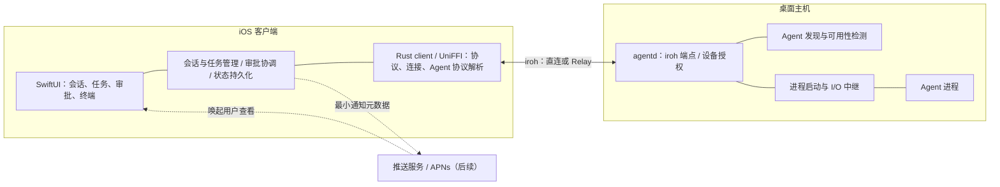
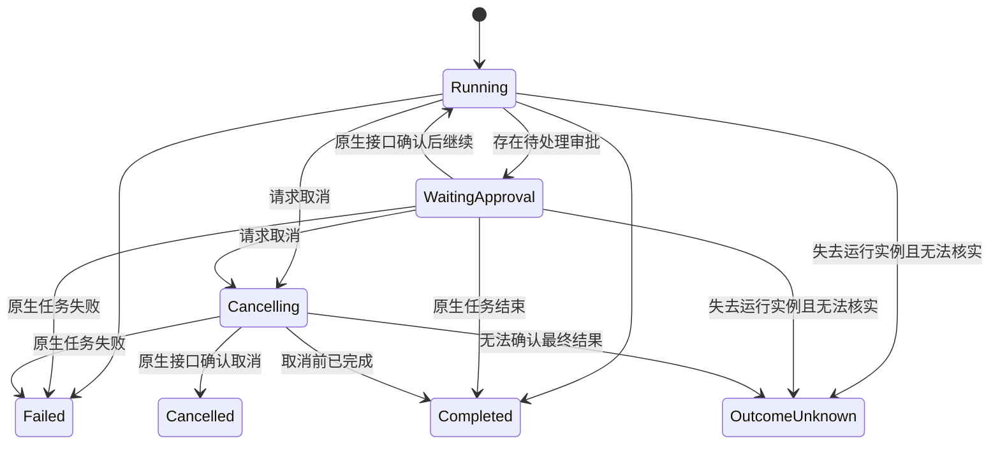

# Agent Bridge — P2P Agent 远程控制方案

通过 iroh P2P 网络从手机连接桌面主机（macOS / Windows / Linux），统一查看和控制 Claude Code、Codex、Herdr 等 Agent。

2026-10-30 · 修订版 v0.2 · 状态：待原型验证 · 核心语言：Rust

本次修订明确了 Agent 接入、审批一致性、断线恢复、安全边界及实施验收标准。文中的协议名称、字段和接口均为设计草案；原生 Agent 接口以锁定版本的实际验证结果为准。


## 01 目标、范围与设计原则

Agent Bridge 进行 Agent 会话管理、结构化事件、审批与移动端交互。桌面端 daemon 负责 Agent 发现、可用性检测和 I/O 中继；手机通过 daemon 直接与 Agent 交互，会话、任务和审批逻辑由手机侧驱动。iroh 的目的在于设备寻址、加密连接、NAT 穿透和中继兜底。

### 首版范围

- 桌面主机（macOS / Windows / Linux）上运行用户级 daemon，仅负责 Agent 发现、可用性检测和进程 I/O 中继；不在 daemon 侧维护会话或审批状态。
- iOS 提供最小控制面板，承担会话管理、任务调度和审批协调；Android 后续扩展。
- **首版一对一**：一部手机配对并控制一台桌面主机。多主机支持作为后续扩展，不在首版 UI 和协议中承诺。
- 先支持一个通过验证的结构化 Agent，支持创建会话、发送任务、接收事件、审批、取消及网络断线恢复。
- 首版控制由手机通过 daemon 中继创建或通过已验证原生接口恢复的会话，不承诺接管任意已有终端中的 Agent。
- Generic PTY 提供远程终端能力；没有可靠接口时不提供结构化审批。
- 主机必须保持唤醒、用户会话可用且可联网。Relay 不能唤醒休眠的主机，也不能代替它执行任务。
- 手机断线后，daemon 保持 Agent 进程运行；daemon 或机器重启后的进程无损恢复不属于首版承诺。

### 设计原则

1. 优先原生协议或 SDK，PTY 用于需要终端的适配器。
2. 统一业务能力和事件，不要求所有 Agent 具有相同底层交互方式。
3. 审批必须关联真实原生请求；文本猜测仅作为提醒。
4. 状态可查询、事件可同步，推送通知只是提醒通道。
5. 对恢复失败、输出缺失和执行结果未知进行显式表达。

## 02 整体架构



### 职责边界

| 层 | 职责 | 边界 |
|---|---|---|
| iroh | 加密传输、设备端点身份、直连与中继 | 不管理 Agent 权限和会话恢复 |
| ABP 协议 | Agent 发现、进程管理请求、I/O 中继帧 | daemon 不解释 Agent 协议内容 |
| daemon | 设备授权、Agent 探测与可用性、进程生命周期、I/O 转发 | 不持有会话、任务或审批状态 |
| Agent 适配器 | 进程启动、I/O 管道、停止、可选 PTY | 协议解析和业务逻辑在手机侧 |
| 移动端 | 会话管理、任务调度、审批协调、事件解析、状态持久化 | 权威状态在手机本地；展示和操作入口 |

结构化 Agent 的输出作为事件展示，不要求同时存在可附着的终端。只有声明 `terminal` 能力的会话才开放终端流。

## 03 控制协议设计

在 iroh 连接上定义 Agent Bridge Protocol（ABP）。以下是 v1 草案，Phase 0 完成原生接入验证后冻结首版 schema。

### 握手与帧格式

连接使用明确的应用协议标识，例如 `agent-bridge/1`，在锁定 iroh 版本后验证 ALPN 配置。设备认证后进行 Hello 协商，包含协议主次版本、客户端实例 ID、服务启动实例 ID、能力集合及消息大小限制。不兼容主版本拒绝连接；次版本新增字段遵循兼容规则。

```text
frame = len:u32(BE) + type:u8 + payload:protobuf
len 表示 type + payload 的字节数，不包含长度字段本身。
1 <= len <= 协商后的 max_frame_bytes；首版默认上限 1 MiB。
```

先校验长度再分配内存；增量读取，不假设一次 read 对应一帧。大文件或输出分块传输，另外限制连接数、流数、消息速率、队列和总内存。未知类型返回协议错误并关闭相应流，不执行未知操作。

### 流类型

每条流先传递 `StreamOpen { kind, session_id?, run_id?, cursor? }`，服务端完成授权并返回确认后才接收业务数据。

| 类型 | 方向 | 用途 |
|---|---|---|
| Control | 双向 RPC | 握手、Agent 发现与状态查询、进程启动/停止 |
| AgentIO | 双向 | Agent 进程 stdin/stdout 的透传中继；手机侧解析 Agent 协议 |
| Terminal | 双向 | 指定运行实例的 PTY 输出、输入和尺寸变更 |
| File | 双向 | 后续支持的受限文件预览与 diff 分块读取 |
| Pair | 双向 | 配对窗口中的受限握手，不允许执行控制操作 |

Control 流负责 daemon 自身的操作（发现、进程管理）；AgentIO 流是 Agent 进程 I/O 的透传通道，daemon 不解析其内容，手机侧 Rust 层在此之上实现 Agent 原生协议的解析、会话管理和审批。

### RPC 与重试语义

#### daemon Control RPC

请求信封包含 `rpc_id`、`method`、`timeout_ms` 和请求体。响应通过 `rpc_id` 关联，返回结果或明确错误。

- Agent 发现和状态查询可安全重试。
- 进程启动/停止操作携带 `operation_id`；daemon 持久化简单的去重记录，防止重复启动。
- 错误至少区分：未授权、不支持、参数错误、Agent 不可用、进程已退出、资源限制。

#### 手机侧业务去重与一致性

- 会话、任务、审批等业务操作的去重在手机本地数据库完成，使用 `operation_id` 建立唯一约束。
- 操作先记录意图再通过 AgentIO 发送给 Agent；无法确认的操作标记 `OutcomeUnknown`，重连后通过 Agent 状态查询核实。
- 手机断线重连后，先查询 daemon 进程状态，再通过 AgentIO 恢复与 Agent 的协议状态。
- 去重记录首版保留至少 7 天；超过有效期的旧操作不自动重放。

### 核心操作与标识

#### daemon Control 操作（ABP 协议）

| 操作 | 主要输入 / 结果 |
|---|---|
| ListAgents | 返回已安装版本、适配器版本、验证状态和能力 |
| StartProcess | Agent 类型、配置 → `process_id`、I/O 中继就绪 |
| StopProcess | 停止指定进程，返回操作状态 |
| GetProcessStatus | 查询进程存活、退出码 |
| AttachTerminal / ResizeTerminal / DetachTerminal | 仅适用于声明终端能力的实例 |
| Ping / GetSystemInfo | 心跳、资源和运行条件 |

#### 手机侧 Agent 交互（通过 AgentIO 中继）

手机 Rust 层通过 AgentIO 流与 Agent 直接通信，在本地维护以下状态和操作：

| 操作 | 说明 |
|---|---|
| 会话管理 | 创建、恢复、停止会话；`session_id`/`run_id` 由手机生成并与原生会话 ID 映射 |
| 任务提交与取消 | SubmitTask、CancelTask、事件接收和任务状态跟踪 |
| 审批协调 | 解析原生审批请求、展示卡片、发送决定、跟踪审批状态 |
| 事件与状态同步 | 解析 Agent 事件流、维护 `event_seq`、本地持久化 |
| 操作去重 | 使用 `operation_id` 在手机本地数据库去重 |

`session_id` 标识逻辑对话，`run_id` 标识一次真实运行，`task_id` 标识任务。原生会话 ID 与这些标识单独映射；恢复后创建新的 `run_id`，旧实例的输入和审批必须被拒绝。

### 会话与任务状态

会话状态：`Starting → Ready → Stopping → Exited`；启动失败进入 `Failed`；失去原生实例联系或 daemon 重启后进入 `RecoveryRequired`，核实或显式恢复后才能继续操作。

任务状态独立于会话状态：



审批拒绝是否导致任务失败由原生 Agent 决定，不直接从用户按钮推断。单任务可以同时存在多个审批请求；`WaitingApproval` 是汇总状态。任务完成后会话可以继续接收下一轮任务，进程退出码只属于会话退出事件。

### 审批闭环（手机侧驱动）

审批记录至少包含：`approval_id`、`session_id`、`run_id`、`task_id`、原生请求关联 ID、请求版本、操作类型、目标与参数摘要、允许的决定集合、创建时间、到期时间和当前状态。完整记录在手机本地数据库保存；diff 可作为可选附件。

处理流程：

1. 手机 Rust 层通过 AgentIO 流收到 Agent 原生权限请求，解析后持久化审批记录和事件，通知 UI。
2. 用户在手机上查看审批内容，选择决定后由 Rust 层携带审批 ID、请求版本、所选决定及 `operation_id` 通过 AgentIO 发送给 Agent。
3. 手机侧在本地通过原子状态变更保证同一请求只发送一个决定。
4. Agent 确认接受决定后记录 Resolved；这表示决定已送达，不等于工具已经执行成功。
5. 原生请求取消、任务结束或进程退出时使卡片失效。并发的其他决定返回当前状态。
6. 送达结果不确定时进入 OutcomeUnknown，重连后通过 Agent 状态查询核实，不盲目重发。

审批状态包括 Pending、Resolving、Resolved、Cancelled、Expired、OutcomeUnknown。到期策略必须与原生能力匹配：能拒绝或取消时发送相应操作并核实；不能确认时明确显示未知，绝不自动批准。重连必须重新查询待处理列表。

## 04 桌面端 daemon：Agent 发现与 I/O 中继

`agentd` 通过平台对应的用户级服务机制启动（macOS LaunchAgent / Windows 服务或计划任务 / Linux systemd user unit）。daemon 的核心职责是 **Agent 发现、可用性检测、进程生命周期管理和 I/O 中继**，不在本地维护会话、任务或审批状态。Agent 适配器放在独立 crate，协议类型由公共 crate 提供。

### 核心模块

| 模块 | 职责 |
|---|---|
| endpoint / auth | iroh 连接、配对、白名单、逐操作授权和撤销 |
| probe | Agent 发现：扫描已安装 Agent、版本、路径、可用性检测 |
| relay | 进程启动、stdin/stdout/stderr 中继、PTY I/O 转发 |
| platform | 平台抽象：服务注册、安全存储、进程管理、休眠检测 |
| notify | 后续通知服务集成与发送重试 |

daemon 不解析 Agent 协议内容（如 JSON-RPC 消息体、审批请求字段）；它只负责字节级转发。协议解析、会话状态机、审批协调和事件存储均由手机客户端完成。

### Agent 适配器契约（daemon 侧）

daemon 侧的适配器只负责发现、启动和停止 Agent 进程，不解释业务协议：

```text
AgentAdapter (daemon):
  probe() -> InstalledVersion + ValidationStatus + Capabilities
  start(config) -> ProcessHandle   // 启动进程，返回 I/O 管道
  stop(handle) -> OperationResult  // 停止进程
  open_pty(config) -> PtyHandle    // 可选：PTY 模式
```

能力至少区分 `structured_events`、`submit_task`、`approval`、`cancel_task`、`resume`、`terminal`、`file_preview`。能力信息由 daemon 上报给手机，手机据此决定交互方式。不支持的操作在手机侧 UI 隐藏或禁用。

业务交互接口（会话管理、任务提交、审批响应、取消、恢复）由手机侧 Rust 客户端通过 daemon 中继的 I/O 管道与 Agent 直接通信。

| Agent | 首选接入路线 | 必须验证的能力 | 无法验证时的处理 |
|---|---|---|---|
| Claude Code | 官方 SDK 或结构化输入输出的宿主控制通道 | 多轮任务、真实审批请求与回应、取消和恢复 | 仅启用已验证能力；交互终端作为独立模式 |
| Codex | 优先评估本机已有的 app-server | 锁定协议 schema、初始化、任务、审批、恢复和版本兼容 | 未通过验证不宣称支持结构化控制 |
| Herdr | 调研其实际 IPC、事件和会话机制 | 状态来源、审批接口、恢复与进程所有权 | 保留 Generic 终端能力 |
| Generic | PTY | 进程启动、输入输出、尺寸、停止 | 无结构化审批和任务完成判断 |

如官方 SDK 仅提供其他语言实现，可由 Rust 管理小型 sidecar；是否引入 Node/Python 运行时由 Phase 0 验证决定，不预先承诺所有适配代码纯 Rust。

### 运行与恢复边界

| 故障 | 首版行为 |
|---|---|
| 手机断线 / detach | daemon 保持 Agent 进程运行；手机重连后重新同步状态 |
| 网络切换 | 重连、重新授权、同步快照和增量事件 |
| Agent 退出 | 记录退出和任务最终状态；无法确认的任务标记未知，不自动重跑 |
| daemon 崩溃或重启 | Agent 进程可能丢失；手机侧记录标记为 RecoveryRequired |
| 主机重启 | 恢复元数据；仅通过已验证原生恢复机制和显式操作接续对话 |
| 主机睡眠 | UI 显示不可达；唤醒后重新同步，不承诺休眠期间继续执行 |

服务管理器重新拉起 daemon 不等于恢复原来的 PTY。若后续要求 daemon 升级期间保持进程，应单独设计会话宿主或经验证的 tmux/screen/原生后台服务接管方案，并定义所有权与清理规则。

### 输出、事件与背压

- daemon 侧：Agent 进程 I/O 通过有界队列中继到手机。daemon 不解析和存储事件，仅做字节转发。慢客户端不阻塞 Agent 进程输出读取；中继缓冲区满时丢弃旧数据并标记缺口。
- 手机侧：结构化事件使用单调递增 `event_seq`，状态更新与对应事件在同一事务中落盘到手机本地数据库。首版事件保留上限暂定 7 天或 100 MiB，达到任一上限按策略裁剪。
- 会话、当前任务、未决审批和未完成操作属于权威状态，不随历史事件裁剪删除。
- 原始终端输出使用每个 `run_id` 独立的字节偏移，默认 256 KiB 环形缓存只提供尽力回放，不承诺保存所有输出。
- daemon 中继缺口或手机断线导致的数据缺失明确标记，手机侧展示缺失区间，不静默拼接。
- PTY 输出不一定能还原屏幕。首版缓存不足时展示”终端历史不完整”，不宣称完整屏幕恢复。

### PTY 专属规则

同一实例可以有多个只读订阅者，但只有一个带有效租约的终端写入者；断线释放租约，重新连接需重新获取。输入序号用于活动实例内去重，重连后不自动重放未经确认的终端按键。尺寸变化使用控制消息传递。停止操作处理进程组及子进程；多线程异步运行时中避免在 fork 后执行不安全的运行时逻辑，选择经过验证的 PTY 库或独立启动辅助进程。

## 05 移动端：交互核心与 UniFFI 边界

手机是 Agent 交互的核心：会话管理、任务调度、审批协调、事件解析和状态持久化均在手机侧完成。网络、协议解析和 Agent 通信使用 Rust，iOS UI 使用 SwiftUI。绑定采用锁定 UniFFI 版本支持的方式生成；本节是业务契约，不把伪代码当作可编译 UDL。

### Agent 交互层（手机侧 Rust）

手机 Rust 层通过 daemon 中继的 I/O 管道与 Agent 直接通信，承担原文 daemon 侧的业务逻辑：

```text
AgentSession (mobile Rust):
  create(agent, config) -> SessionHandle    // 请求 daemon 启动进程，建立 I/O 中继
  submit_task(session, message) -> TaskRef
  events(session) -> 异步事件流              // 解析 Agent 原生协议
  respond_approval(session, request, decision) -> DeliveryResult
  cancel_task(session, task) -> OperationResult
  stop(session) -> OperationResult
  resume(session_ref) -> SessionHandle      // 可选
  attach_terminal(session) -> TerminalHandle // 可选
```

会话、任务和审批的状态机、操作去重、事件持久化均在手机本地数据库维护。

### 客户端 API 约定

- 每个已连接设备持有独立连接句柄；会话和回调均携带设备 ID，支持未来多主机扩展。
- 手机 Rust 层维护会话、任务和审批的完整状态机，通过 daemon 中继与 Agent 进程通信。
- 网络调用异步返回结果或明确错误，支持取消等待。取消客户端等待不等于取消 Agent 任务。
- 变更操作使用 `operation_id` 在手机本地去重；daemon 侧不参与业务去重。
- UI 订阅标准化事件、同步进度、输出缺口、审批状态和连接状态。
- 高频输出批量派发并限制缓冲；回调切换到 UI 所需线程，防止阻塞 Rust 网络任务。
- TerminalHandle 仅对具有终端能力的会话生成，释放句柄只 detach，不停止 Agent。
- 手机本地数据库持久化会话记录、事件日志和操作去重表；断线重连后通过 Agent 状态查询恢复一致性。

### 视图映射

| 视图 | 数据来源 | 关键交互 |
|---|---|---|
| 设备列表 | 配对记录、连接状态、最近成功同步时间 | 扫码、连接、本地移除与远端撤销入口 |
| Agent 面板 | ListAgents、ListSessions、能力集合 | 创建会话、显式恢复、停止 |
| 会话详情 | 权威快照及事件 | 提交任务、取消任务、查看结果 |
| 审批卡片 | 最新审批记录及允许的决定集合 | 展示操作内容、提交决定、显示处理中和最终状态 |
| 终端 | PTY 输出及输入租约 | 附着、输入、尺寸变化、缺口提示 |

连接状态区分 Connecting、Syncing、Online、Reconnecting、Offline；Direct/Relay 是连接路径属性，不与同步状态混为一谈。回前台时先同步，过期卡片不可直接提交。允许服务端在正常竞态下返回“审批已结束”。

## 06 配对、连接与权限

### 身份与授权

| 层次 | 用途 | 存储与约束 |
|---|---|---|
| iroh 设备密钥 | 认证远端端点身份 | 平台安全存储（macOS Keychain / Windows Credential Manager / Linux Secret Service）；验证锁屏及后台服务访问行为 |
| 配对记录 | 将设备身份绑定到本机授权 | daemon 持久化；支持有效期、修改和撤销 |
| 操作权限 | 限制创建会话、提交任务、审批、终端输入及文件读取 | 每次操作和每条新流均校验；不能只在连接时检查 |
| Agent 执行权限 | 约束 Agent 真实可执行动作 | 使用已验证原生权限或操作系统隔离；不等同于工作目录 |

设置 `cwd` 只决定启动目录。若 Agent 可以运行 shell，它可能访问当前用户有权访问的其他资源。首版按“受信任设备控制当前用户下的 Agent”定义边界，不承诺目录级进程隔离。远程终端输入必须单独授权，文件预览拒绝越界路径并处理符号链接，不能仅依赖字符串前缀判断。

### 扫码配对

二维码包含协议版本、主机 Endpoint ID、连接提示、一次性高熵令牌、有效期和设备名称。有效期由 daemon 生成并校验；示例不硬编码时间戳。

- 用户在桌面端打开短时配对窗口；未配对设备只能使用受限 Pair 通道。
- 手机验证实际服务端身份与二维码 Endpoint ID 一致，令牌绑定本次配对窗口和实际客户端身份，并原子消费，禁止重放。
- 桌面端展示待配对设备并由本地用户确认授予的权限；身份绑定完成后才开放控制流。
- 错误令牌和大量连接受速率限制，令牌和密钥不进入普通日志。
- 撤销设备时关闭现有连接、订阅和写入租约，拒绝后续操作；已送入 Agent 的动作不能保证撤回，必须展示实际状态。
- 手机删除本地记录不等于主机撤销授权，UI 明确区分两种操作。

### 心跳、网络变化与运行条件

Control 心跳初始值为 15 秒，连续 3 次失败判定失联；重连采用带抖动的指数退避，初始 1 秒、上限 60 秒，网络切换时尽快重试。认证失败或设备撤销不无限重试。

iOS 进入后台允许连接中断，回前台进行身份检查和一致性同步。桌面端在首版需保持唤醒；可提供用户主动开启的任务期间防睡眠选项，并清晰展示耗电影响。daemon 启动时检查 Agent 可执行路径、登录状态、环境变量和工作目录，不能假设后台服务拥有交互 shell 环境。

### 推送边界

后续采用受认证的通知服务调用 APNs；不将共享 APNs 服务端签名密钥分发到客户端。通知仅携带最小标识和通用提示，默认不携带命令、diff 或敏感输出。手机打开通知后从 daemon 获取最新审批，通知可能延迟、重复或丢失，不作为状态真相。APNs 接入、设备令牌更新、用户授权、过期通知清理及服务部署属于独立交付项。

## 07 Agent 接入验证与解析策略

### 已核对信息与证据边界

2026-10-30 已读取本机 CLI 帮助：Claude Code 2.1.314、Codex CLI 0.165.0。帮助只能证明入口和选项存在，不代表完整协议已经跑通；此前官方文档站点无法解析，未完成在线文档核验。

- Claude Code 帮助说明 `--output-format stream-json` 和 `--input-format stream-json` 用于 `--print` 模式，并列出了宿主权限提示相关选项。
- 本机帮助没有列出 `--cwd`，启动工作目录应通过子进程 API 设置。
- Codex 的 `app-server --help` 列出了 stdio 等传输及 schema 生成入口。具体初始化、审批和恢复字段必须读取锁定版本 schema 并实测，不能从帮助推断。
- hooks、MCP、结构化输出分别解决不同问题；存在其中一种接口不代表可以远程回答全部权限请求。

### 接入优先级

1. 优先原生控制协议或官方 SDK，验证请求响应关联和取消、审批、恢复语义。
2. 结构化输出可用于观察事件，但只有验证了对应输入和权限控制通道，才开放双向控制能力。
3. ANSI/文本匹配仅产生“可能需要用户处理”的提示，不产生可自动发送 `y/n` 的审批卡片。
4. Generic 使用原始终端，用户明确进入终端后手动操作；不从提示词推断任务成功或真实权限请求。

原生模式不能随时无损切换成同一会话的交互终端。若无终端能力，UI 展示日志和诊断信息；新建终端模式会话必须作为独立操作。

### 增量解析规则

```text
每个运行实例维护独立字节缓冲：
  逐块消费输入，限制完整消息和未完成消息的大小
  找到分隔符后取出完整消息，再进行 UTF-8 与 JSON 解析
  未完成的尾部保留至下一次读取
  EOF 时按已验证协议处理最后一条消息或报告截断
  非法消息记录受控诊断，不静默丢弃审批或状态事件
```

不要对每次 read 直接 split 后尝试解析并丢弃错误。需覆盖半条 JSON、多条合并、UTF-8 跨块、超长行、stderr 混入、原生字段变更及进程中途退出。结构化 stdout 与诊断 stderr 分开读取；PTY 的换行、回显和终端控制会影响机器协议，因此机器接口优先使用管道。

### 适配器兼容性记录

每个适配器提交经过验证的 CLI/SDK 版本、schema 来源、启动参数、权限模式、真实脱敏事件样本、审批决定映射、取消与恢复限制。版本不匹配时提示未验证；关键协议校验失败时停止相应变更操作，不继续猜测字段。

## 08 项目结构与依赖

```text
agent-bridge/
├── Cargo.toml
├── crates/
│   ├── abp-protocol/          # 消息 schema、帧、公共 ID 和错误
│   ├── agentd/                # 网络、授权、Agent 发现、I/O 中继
│   ├── agent-adapters/        # Agent 探测、进程启动/停止、I/O 管道
│   ├── agent-bridge-client/   # Rust 客户端：Agent 协议解析、会话/任务/审批状态机、本地存储、UniFFI 导出
│   └── abp-test-harness/      # 假 Agent、故障注入、协议兼容验证
├── sidecars/                  # 仅在 SDK 接入需要时引入
├── ios/                       # SwiftUI 客户端
├── fixtures/                  # 脱敏协议样本和版本清单
├── scripts/                   # XCFramework、安装、打包
└── README.md
```

| 依赖 | 用途 | 决策要求 |
|---|---|---|
| iroh | P2P、Relay、端点身份 | 锁定版本，验证 iOS 真机、各桌面平台与网络切换 |
| tokio | 异步任务和 I/O | 控制队列容量、取消和子进程清理 |
| prost | Protobuf 消息 | 固定字段编号，保留废弃编号并验证版本兼容 |
| uniffi | Swift/Kotlin 绑定 | 提前验证异步回调、线程和资源释放 |
| PTY 库 / nix / winpty | 终端模式 | 验证各平台进程组、resize、fork/spawn 安全 |
| SQLite（daemon 侧） | Agent 发现缓存、进程记录、配对与去重 | 轻量即可；daemon 不存会话/审批状态 |
| SQLite（手机侧） | 会话、任务、审批、事件、操作去重 | 完整事务、迁移和崩溃恢复 |
| serde / tracing | 配置、结构化解析与诊断 | 脱敏，默认不记录令牌和完整命令输出 |
| security-framework / platform cred | 平台安全存储 | 验证各平台后台运行和锁屏行为 |

## 09 分阶段实施计划

### Phase 0 — 本地 Agent 控制闭环

先验证最大不确定性，暂不构建完整移动 UI。

- 调研 Claude Code 和 Codex 原生接口，选择一个先跑通，记录选择依据。
- 用本地测试客户端验证创建会话、提交任务、真实审批、拒绝、取消、下一轮任务及原生恢复能力。
- 建立标准化事件、能力声明、审批状态与原生 ID 映射；选定状态存储。
- 验证结构化模式与终端模式的边界，决定是否需要 SDK sidecar。

**验收：** 工具调用在审批前确实未执行；批准后按原生规则执行；拒绝、过期、双客户端竞争和重复提交不会误作用于其他请求；取消和下一轮任务可观察；恢复能力有明确实测结论。无法验证审批闭环时，不进入“支持远程审批”的产品开发。

### Phase 1 — 已授权的 P2P 控制与状态恢复

- 实现 iroh、ABP、身份授权、操作幂等、状态快照及增量事件。
- 初期可通过本地方式配置设备白名单；任何可远程启动 Agent 的入口必须先有认证授权。
- 实现断线、消息丢失、输出裁剪、慢客户端和 daemon 重启的故障处理。
- 实现受限配对通道和撤销；扫码及桌面端托盘/菜单栏外观后续完善。

**验收：** 未授权设备无法操作；StartSession 响应丢失后重试不重复启动；并发审批只提交一个决定；旧 run_id 被拒绝；手机断网不阻塞 Agent；输出缺口被明确报告；服务重启后不会自动重跑结果未知的任务。

### Phase 2 — 最小 iOS 真机闭环（验证工作提前开始）

Phase 0 期间即可开始空壳 iOS 的 Rust/UniFFI 编译与连接验证，避免到后期才发现平台障碍；完整交互依赖 Phase 1 的协议。

- 构建 XCFramework，验证真机运行、异步回调和生命周期。
- 实现设备列表、会话详情、审批卡片及扫码入口。
- 实测 Wi-Fi/蜂窝切换、后台挂起、回前台同步、Direct 与 Relay。

**验收：** 真机完成任务和审批；回前台先恢复权威状态；过期审批不可误执行；慢 UI 不阻塞网络和 Agent；主机睡眠与不可达状态有明确呈现。

### Phase 3 — MVP 收敛与发布准备

- 完成平台服务注册（macOS LaunchAgent / Windows 服务 / Linux systemd）、环境诊断、桌面端托盘配对和设备管理。
- 完成单 Agent 正式支持、能力说明、资源上限、日志导出及数据迁移。
- 仅在具备终端组件时开放 Generic PTY，包含输入租约、resize 和缺口提示。

**验收：** 完成全新安装、登录失效、设备撤销、磁盘故障、进程退出和升级后的行为验证；明确展示重启恢复边界，不把 daemon 自启动宣传为任务无损恢复。各平台（macOS / Windows / Linux）均通过基本冒烟测试。

### Phase 4 — 多 Agent、推送与扩展

- 按同一验收标准接入其他 Agent，而非只做提示文本匹配。
- 实现通知服务/APNs、受限文件预览与 diff、多设备并发查看。
- 根据实际需求评估独立会话宿主、完整终端屏幕快照和 Android。

**验收：** 各适配器独立通过审批和故障测试；重复或过期推送不改变权威状态；文件读取不能越过授权边界；终端多客户端写入可仲裁。

## 10 待确认项与风险

| 项目 | 当前结论 / 待验证内容 | 关闭阶段 |
|---|---|---|
| 原生审批 | CLI 帮助不是协议验证；需真实请求、决定和执行结果样本 | Phase 0 |
| Agent 版本与恢复 | 锁定版本、保存兼容性记录；恢复对话不等于恢复执行现场 | Phase 0 |
| SDK sidecar | 根据实际可用接口决定语言与分发方式 | Phase 0 |
| 幂等与崩溃窗口 | 外部执行与数据库无法天然原子提交，保留结果未知状态 | Phase 1 |
| iroh / Relay | 不保证所有网络可达，验证 UDP 受限、Relay 不可用和网络切换 | Phase 1–2 |
| iOS / UniFFI | 提前验证真机编译、后台挂起、线程和资源释放 | Phase 0–2 |
| 存储与背压 | daemon 侧轻量中继缓冲；手机侧明确保留策略和慢网络隔离 | Phase 1–3 |
| 桌面端环境 | 各平台服务注册、安全存储、登录状态、休眠与进程清理 | Phase 2–3 |
| 资源并发 | 每适配器消耗不同，限制会话数、进程数、内存、队列和磁盘 | Phase 3 |
| 推送服务 | APNs 认证、设备令牌、服务部署、延迟与丢失 | Phase 4 |
| 文件与命令权限 | 工作目录不是隔离；文件预览与 shell 权限分别验证 | Phase 1 / 4 |

