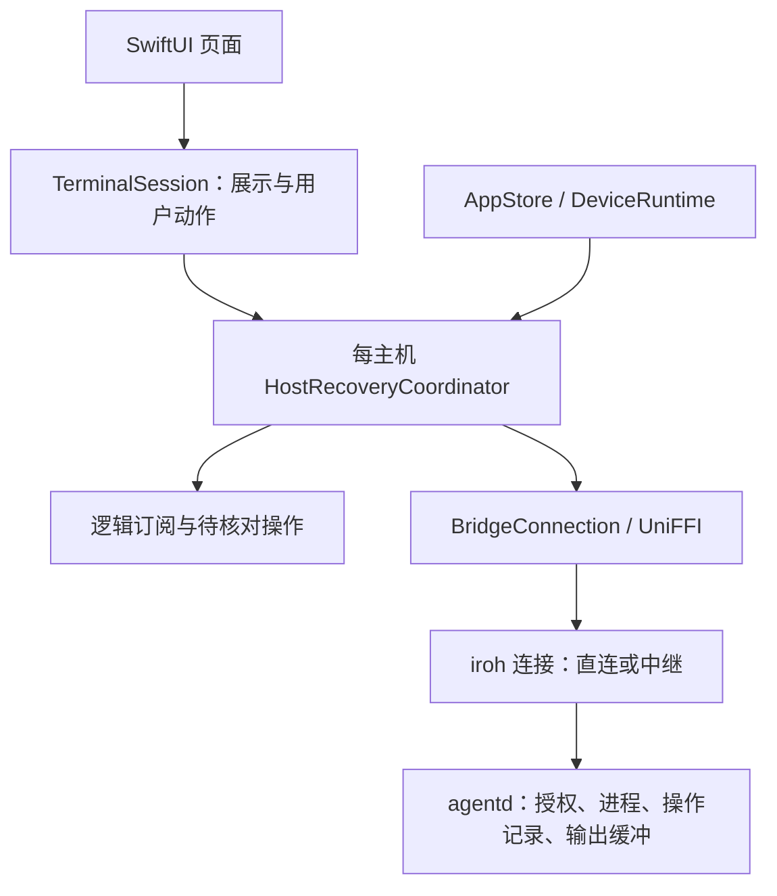
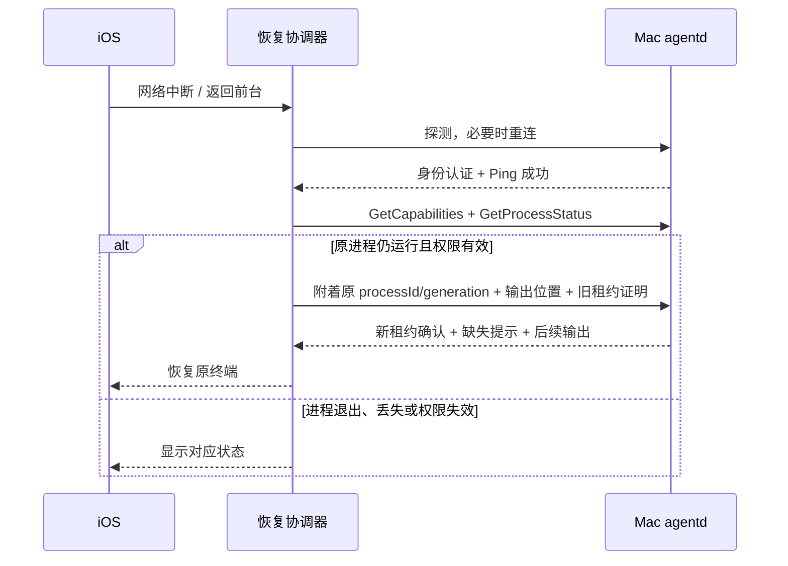

# 弧连连接恢复与会话连续性实现方案

> 2026-11-01 实施状态：远程 Codex 图文聊天现已落地同进程字节续接、租约交接、完整 NDJSON 输入提交、前台恢复及有界任务核对。具体契约与验证见 `.trellis/tasks/11-01-codex-images-recovery/`。下文仍包含后续规划：通用终端恢复、操作日志查询、配对 journal、APNs 等并未全部实施。

版本：草案 v1.0\
日期：2026-11-01\
状态：供实现评审；本文定义后续开发方案，不代表功能已经实现。

## 1. 目标与范围

保留现有 Rust + iroh + ABP + UniFFI + SwiftUI 架构，借鉴 Orca 的逻辑会话、存活检测、分类恢复、配对日志及故障回放机制。

首期交付一个可验证闭环：**手机切网或短暂断线后，自动恢复到原 Mac 的原进程，继续显示输出，不重复启动进程、不重放输入。**

| 编号 | 优先级 | 交付内容 |
| --- | --- | --- |
| REC-01 | P0 | 每台 Mac 独立的恢复协调器和状态模型 |
| REC-02 | P0 | 认证活动驱动的健康检测、前后台恢复及分类重试 |
| REC-03 | P0 | 原进程重新附着、输出续传、单写入租约交接 |
| REC-04 | P0 | 变更操作的结果核对与幂等恢复 |
| REC-05 | P0 | 可读的恢复状态、受限诊断日志和故障回放测试 |
| REC-06 | P1 | 配对中断恢复和本地保存失败后的重试 |
| REC-07 | P2 | 独立 APNs 通知通道 |

首期覆盖由弧连创建并拥有的真实进程。Codex/Claude 导入历史继续只读；现有本地模拟聊天不在本方案中变成真实 Agent 聊天。Mac 主程序退出或主机重启后，按现有生命周期将旧进程视为已结束或 lost，不承诺跨主机重启恢复。

iroh 继续负责 NAT 穿透、直连、中继选择及可用的路径迁移。应用层不自行重复建立 LAN/Relay 竞速器，不复制 Orca 的 WebSocket 中继架构或自定义加密协议。推送服务独立规划。

## 2. 现状与实际缺口

| 位置 | 已具备 | 本次需要补齐 |
| --- | --- | --- |
| `BridgeConnection` | 每主机连接、共享手机 Endpoint、RPC、独立 AgentIO 流 | 可观测的连接代次、认证活动时间、端到端截止时间及恢复接口 |
| `AppStore.refreshDevice` | 15 秒轮询、连续两次 RPC 失败后重拨、异步代次保护 | Ping 与 Agent 检测故障分离；重拨后确认业务可用；分类退避 |
| `DeviceRuntime` | 每台 Mac 独立运行态 | 恢复协调器、订阅注册表、健康证据及连接状态分层 |
| `TerminalSession` | 显式 start/attach/stop、输出回调、离开页面 detach | 网络恢复后自动附着；旧回调隔离；输出连续性 |
| ABP AgentIO | 字节 offset、gap、单写入租约、64 KiB 输出环形缓冲 | 跨连接输出位置恢复；半开旧连接的租约交接 |
| 进程操作 | `(peer, operation_id)` 幂等、请求指纹、outcome_unknown | 手机持久化待核对操作；按操作 ID 查询结果 |
| iOS 生命周期 | 前台检查、离开前台停止检查、保留可见状态 | 区分 inactive/background；回前台主动核对，防止计时器误判 |

已核实的协议限制：

- `StreamOpen.cursor` 已存在，但当前主机明确拒绝非零值。
- 网络层 `IoFrame.cursor` 在每次附着时从头计数，不能直接作为跨连接恢复位置。
- 当前重新附着从保留缓冲重放；Swift 会清空显示，未使用 offset 去重。
- 旧 AgentIO 租约未释放时，新的 attach 会返回 conflict。
- 当前 RPC 超时主要覆盖读取响应；打开流、握手和写入也应纳入统一调用截止时间。

## 3. 总体架构与职责



### 3.1 唯一恢复调度者

新增 `HostRecoveryCoordinator`，每台 Mac 一个，归 `DeviceRuntime` 所有。负责健康探测、重连单航班、重试计划、连接代次变化后的订阅恢复和操作核对。

`AppStore` 只触发前后台/网络变化/用户重试事件并投影状态；`TerminalSession` 注册或取消订阅。它们不再分别创建独立的重拨循环。Swift 是恢复策略的唯一所有者，Rust 负责连接和有界 I/O，防止两层同时退避重试。

### 3.2 分层状态

运行态建议拆为：

- `transportState`：idle / connecting / connected / disconnected。
- `hostHealth`：unknown / checking / healthy / degraded / unavailable。
- `recoveryState`：idle / scheduled / reconnecting / restoring / needsPairing / blocked。
- `agentAvailability`：每个 Agent 独立的检测结果。
- `subscriptionState`：attached / recovering / ended / blocked。
- `selectedPath`：direct / relay / unknown，仅投影 iroh 真实路径。

这些是临时状态，不写入设备 JSON。网络路径变化而连接仍有效时，只更新路径标签，不重拨、不重新启动进程。

### 3.3 两种代次

保留现有生命周期 generation，用于取消后台、移除设备等过期任务；新增或明确连接 epoch，用于标记物理连接更换。订阅另有自己的 attachment epoch。

所有输出、错误和退出回调同时校验设备、进程 generation、连接 epoch 和 attachment epoch。关闭旧 handle 不能清理新 handle；旧回调不能追加输出或把当前会话改为失败。

## 4. 健康检测、重试和生命周期

### 4.1 健康证据

Rust 层记录最后一次通过身份认证、协议校验和响应关联检查的有效入站时间。流内有持续输出时，不需要额外高频 Ping。Agent 检测失败只改变对应 Agent 可用性，不能清空其他 Agent 或判定整台 Mac 离线。

正常连接初始策略：20 秒没有有效入站数据后发起一次轻量 Ping，最多等待 8 秒；连续三次在有效前台执行窗口内失败后才重建连接。参数集中配置并由测试注入。不能直接把现有带额外宽限的 RPC timeout 当成该 8 秒截止时间。

有效数据到达即清零探测失败计数。同一时刻只允许一个存活探测；网络变化事件先触发探测，不直接关闭健康连接。

连接、打开流、Hello、请求写入及响应读取共享一次调用的总截止时间；阶段耗时仅用于诊断，不能逐阶段叠加成无界等待。

### 4.2 恢复策略

| 故障类别 | 动作 | 停止条件 |
| --- | --- | --- |
| 网络超时、连接中断 | 指数退避并加入随机抖动，初始基准 1/2/4/8/15/30 秒，封顶 30 秒 | 后台挂起、设备移除或成功恢复 |
| 网络不可用 | 等待系统网络可用事件，保留用户手动重试入口 | 网络恢复 |
| 主机不可达 | 显示“暂时无法连接 Mac”，降低重试频率 | 恢复或明确认证错误 |
| 对端明确撤销授权 | 停止自动请求，进入 needsPairing | 用户重新配对 |
| 当前操作权限不足 | 仅阻止该操作，说明所需权限 | 权限更新 |
| Keychain 不可用、凭证缺失或冲突 | 保留原记录，按错误类别提示解锁、重试或重新扫码 | 对应问题解决 |
| 协议不兼容 | 明确提示升级一端，避免快速循环 | 版本更新 |
| Agent 检测失败 | 主机继续在线，独立刷新 Agent 状态 | Agent 恢复 |
| 进程已退出或 lost | 结束订阅，显示真实进程状态 | 用户显式新建进程 |

单纯不可达无法证明 Mac 休眠或退出，界面不得据此猜测原因。当前 `unauthorized` 同时可能表示撤销和权限不足，需由新能力接口或明确错误细分获得权威证据；旧主机的模糊错误先核对 view 权限，不能直接宣布配对失效。

至少持续健康 30 秒后重置连接失败退避，避免短暂连上导致高频重试。手动重试可提前一次网络重试，但不能绕过授权、Keychain 或协议兼容限制。

### 4.3 前后台

- `inactive`：停止新的周期任务和过期状态发布，不因控制中心、权限弹窗而主动断开或显示离线。
- `background`：暂停重试及目录刷新；记录进入时间，可保留短暂宽限，但不依赖后台定时器一定执行。
- `active`：核对实际离开时长，立即做一次有界健康探测；旧连接失效才重拨，随后恢复订阅和核对操作。
- 使用单调时钟管理前台截止时间和退避；跨生命周期另记录时间证据，检测到挂起或时钟异常时重新探测，不把迟到计时器算作真实网络超时。

## 5. 原进程和输出恢复

### 5.1 恢复流程



只有当前仍被页面持有或明确声明需要恢复的订阅参与恢复。离开页面取消订阅，不停止 Mac 上的进程；恢复完成前用户关闭页面时，关闭迟到的新 handle。

### 5.2 输出续传契约

采用 **stdout/stderr 各自的下一字节 offset**，不改变既有 cursor 的含义。

建议在 `StreamOpen` 中添加可选的 `IoResume` 消息，使用新 protobuf tag；字段包括 stdout/stderr 的 next offset，以及可选旧租约标识。旧调用 `cursor=0` 且不传 resume 时维持现有行为。

新增 `GetCapabilities` 控制 RPC，返回已验证功能，例如 `io_resume_offsets_v1`、`io_lease_replace_v1`、`operation_lookup_v1`。连接 epoch 更换后重新获取；不认识该方法的旧主机按 legacy 处理。客户端必须确认能力后才发送新恢复字段，避免旧服务端静默忽略。

主机恢复规则：

1. 校验设备授权、进程所有权和 generation。
2. 验证请求 offset 不超过该通道已产生的末尾位置；非法未来位置返回明确错误。
3. 原子获取输出缓冲快照和恢复位置，正确处理请求落在保留块中间的情况。
4. 已回收的字节按通道先发送 gap，再发送仍可用的数据；无保留块但仍有缺失字节时也要发送 gap。
5. 沿用 64 KiB 缓冲上限；不承诺任意时长离线后的完整输出。
6. 已退出进程显示退出状态。首期不新增退出进程的流式重放保证。

客户端只有在数据已被当前终端缓冲接收后才推进对应 offset；对重复或重叠字节裁剪去重，对跳跃明确显示缺失。处理 UTF-8 跨块拆分，不能把每个原始 chunk 独立解码后直接拼接而丢失字符。

首期恢复位置与终端输出共同保留在内存。App 被杀后不恢复孤立的旧 offset，应重新显示主机保留的片段并注明范围。后续若要跨 App 重启续传，必须将本地输出与 checkpoint 一致落盘，不能仅持久化 offset。

旧主机继续使用有限缓冲重放，在新显示片段中注明“仅显示保留输出”，避免暗示完整续传。

### 5.3 单写入租约交接

新 attach 成功应返回不进入普通日志的 leaseId。恢复时携带 previousLeaseId，服务端仅在同一授权设备、同一进程 generation 且旧租约匹配时原子替换。

旧输入队列仍必须在执行前验证租约；替换后拒绝旧 lease 的待执行输入。旧 session 的 Drop 仅能清除自己的租约，不能释放新租约。无旧租约证明时返回 conflict，客户端不强行接管，不以新建进程规避。

租约证明首期只在内存保存。冷启动遇到仍活跃的旧租约时有界等待旧连接释放，并显示占用状态；若需跨 App 崩溃立即交接，另行设计 Keychain 中的租约恢复证明。

## 6. 命令交付和结果核对

### 6.1 保留现有幂等基础

继续使用主机 `(peer, operation_id)` 记录和请求指纹，不以新的 operation_id 重试旧用户动作。启动和停止都在发送前将 operation_id 与规范化参数写入手机的 pending operation 记录；本地保存失败则不发送。

新增只读 `GetOperationStatus(operation_id)`：

- `not_found`：主机尚无记录，可按原 operation_id 重试；并发到达仍由服务端幂等收敛。
- `reserved/unknown`：可能执行，进入结果核对或明确的人工处理，不自动重复。
- `finished`：返回已记录的结果，再核对对应进程当前状态。

查询仅允许认证 peer 读取自己的记录，并再次检查当前权限。该查询直接查主键，不依赖有条数上限的 `ListProcesses`。

若首次 StartProcess 响应丢失，手机可能没有 processId，因此必须按 operation_id 找回结果；已有 processId 后再调用 GetProcessStatus。旧主机不支持操作查询时可复用原 ID/原参数调用现有幂等接口，收到 outcome_unknown 后停止自动动作。

### 6.2 区分失败和结果未知

Rust 内部记录请求发送阶段；未尝试发送的错误可判定未交付，部分写入、写入完成但响应丢失均保守判定交付未知。新增恢复专用 API/结果类型提供该信息，旧 FFI 异常签名保持兼容。

原始 stdin 没有应用级确认和去重协议，**断线后不自动重放输入**。提示用户检查终端结果。只读 RPC 可以重试，但仍受 generation 和取消状态限制。

## 7. 展示、诊断和测试

### 7.1 展示

设备页展示主机健康和真实路径；终端独立展示“正在恢复输出”“进程已退出”“输出缺失”“需要重新配对”。目录缓存与在线状态分离，网络失败不清空已有对话列表。

诊断记录连接 epoch、错误类别、尝试次数、阶段耗时、路径、订阅恢复次数和缺失字节数。使用轮转且有总量上限的本地日志。默认排除令牌、租约证明、终端输入输出、对话内容、完整文件路径和二维码载荷；诊断导出由用户主动触发。

### 7.2 回放矩阵

测试注入时钟、随机数和 transport，使用脱敏事件/期望结果 fixture；不直接录制真实聊天和密钥。

| 场景 | 必须满足 |
| --- | --- |
| Wi-Fi 切蜂窝，原连接仍有效 | 继续原流；路径变化不引发额外启动 |
| 连接实际中断后恢复 | 同一进程自动附着；无重复输出 |
| 断在输出块中间 / UTF-8 字符中间 | offset 裁剪正确，字符不损坏 |
| 离线期间缓冲回收 | 明确 gap，缺失数量正确，无虚假完整性 |
| 新连接已恢复，旧回调迟到 | 不覆盖新状态、不追加旧输出 |
| attach 时旧租约仍活跃 | 合法证明原子交接；无证明不接管 |
| 替换租约时旧 stdin 已排队 | 执行前拒绝旧租约 |
| 启动已执行但响应丢失 | 找回同一结果，最多启动一次 |
| 停止响应丢失 / 原始输入交付未知 | 停止可核对；原始输入不自动重放 |
| 控制中心、后台挂起、长时间回前台 | 不误报撤销；有界探测后恢复 |
| 仅 Agent 检测失败 | 主机不被误判离线 |
| 撤销授权或进程 generation 变化 | 停止恢复，不附着错误进程 |
| A、B 两台 Mac；移除 A | B 的连接、任务和订阅不受影响 |
| 新旧两端组合 | 能力协商有效，旧端按受限模式展示 |
| 目录刷新失败 / 成功返回空 | 失败保留缓存；成功按目录契约更新 |

网络行为先由假时钟和 loopback 证明，再进行真实 Mac + iPhone 的 LAN、蜂窝、强制中继、主机休眠和后台恢复验收。模拟器测试不能代替蜂窝网络证据。

初始性能验收目标：网络重新可用且 Mac 醒着、前台主动探测能够成功时，90% 的实机恢复样本在 15 秒内恢复主机和现有终端；分别记录网络事件、认证完成和终端恢复耗时。普通失联探测窗口与退避等待单独统计，不承诺任意网络环境下固定恢复时长。

## 8. 改动位置与实施顺序

| 工作包 | 主要位置 | 交付与依赖 |
| --- | --- | --- |
| W1 协议与边界 | `crates/abp-protocol/schema/abp-v1.proto`、`crates/abp-protocol/src/lib.rs`、`crates/agentd/src/network.rs` | 能力查询、恢复字段、租约确认；新旧版本测试 |
| W2 主机恢复能力 | `crates/agentd/src/{process,lib,store}.rs` | 按通道恢复、租约交接、操作查询；依赖 W1 |
| W3 Rust 客户端 | `crates/agent-bridge-client/src/connection.rs`、`src/endpoint.rs` | 新增 resume API、连接 epoch、健康证据、总截止时间；依赖 W1/W2 |
| W4 iOS 协调器 | 新 `HostRecoveryCoordinator.swift`、`AppModel.swift`、`DeviceStorage.swift` | 状态投影、单航班重连、分类退避、pending operation；依赖 W3 |
| W5 终端与界面 | `TerminalSession.swift`、`ChatView.swift`、相关设备视图 | 订阅恢复、offset 去重、UTF-8 解码及恢复状态；依赖 W4 |
| W6 集成验收 | Rust harness、iOS 单测/UI 测试、真实双端 | 全部故障矩阵及新旧版本；每个工作包同步增加所属测试 |

每个工作包合入前应具备自己的回归证据。W1 先冻结线协议语义；完成 W1～W6 才算首期闭环交付。UniFFI 接口变化必须同时更新 Swift 绑定与真机/模拟器 XCFramework，Mac 宿主也使用对应新代码。

建议验证命令：

```sh
cd agent-bridge
cargo test -p abp-protocol -p agentd -p agent-bridge-client -p abp-test-harness --locked
cargo check -p agent-bridge-desktop --locked
bash scripts/ios-build-client.sh
cd ios
xcodebuild -project AgentBridge.xcodeproj -scheme AgentBridge \
  -destination 'platform=iOS Simulator,id=<明确选择的模拟器 UUID>' \
  -only-testing:AgentBridgeTests test CODE_SIGNING_ALLOWED=NO
```

上列是后续实施的验证要求，本次方案整理没有执行这些命令或宣称通过新功能测试。

发布先升级 Mac 主机，再升级 iOS；混合版本以能力协商降级。回滚客户端恢复功能时保留原 start/attach 接口；主机协议字段保持向后兼容，不改变旧字段 tag 和 cursor 含义。

## 9. 后续阶段

### P1 配对中断恢复

新增配对 journal：记录目标 endpoint、手机身份引用、阶段、请求 ID、待保存设备描述和临时 Keychain 引用。元数据与秘密分离，客户端不得把一次性邀请令牌转成可反复使用的授权。

Mac 已批准、手机尚未提交本地记录的场景：以同一手机身份和原 endpoint 查询当前授权，再原子保存设备；不要重新提交已消费的邀请。尚未批准且邀请已过期时重新扫码。取消操作只清理本次暂存凭证，不能删除已配对设备共用的密钥或中继租约。先验证现有一次性配对协议是否足够表达查询，再确定增量接口。

### P2 APNs 通知

独立部署小型推送网关。Mac 以自身身份认证，手机显式注册设备 token；按事件 ID 去重并清理失效 token。第一版只支持弧连拥有的真实进程“退出/失败”，不把进程退出码 0 当作模型任务语义完成。

待真实 Agent 适配器能提供可信事件后，再增加任务完成和待审批通知。推送只提示事件，打开 App 后重新授权查询真实状态；推送失败不影响任务执行，默认不包含命令或聊天正文。APNs 是锁屏通知路径，不用于维持后台常驻连接。

## 10. Orca 参考实现

以下作为设计参考；不把其技术栈和全部服务模块搬入弧连。

- [逻辑会话与订阅重建](https://github.com/stablyai/orca/blob/main/mobile/src/transport/stable-logical-rpc-client.ts)
- [认证活动驱动的存活检测](https://github.com/stablyai/orca/blob/main/mobile/src/transport/rpc-session-liveness-watchdog.ts)
- [错误分类与恢复门槛](https://github.com/stablyai/orca/blob/main/mobile/src/transport/mobile-relay-reconnect-controller.ts)
- [前后台宽限处理](https://github.com/stablyai/orca/blob/main/mobile/src/transport/mobile-relay-background-grace.ts)
- [配对日志](https://github.com/stablyai/orca/blob/main/mobile/src/transport/mobile-relay-pairing-journal.ts)
- [场景回放 fixture](https://github.com/stablyai/orca/tree/main/mobile/rpc-foundation/goldens)
- [中继与推送服务边界](https://github.com/stablyai/orca/blob/main/cloud/README.md)
