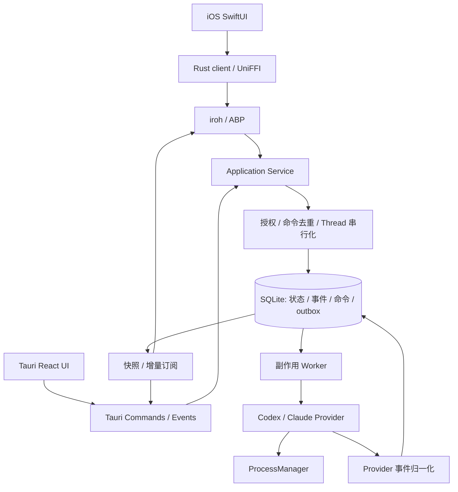

# ArcLink 多 Agent 与多端实时协同技术实现方案

> 日期：2026-11-21
> 状态：设计草案，尚未实施。
> 基线：当前 feature/agent-bridge-desktop 分支，HEAD 55e2a98。
> 范围：Mac agentd、Tauri 桌面端、iOS、Rust 客户端和 ABP 协议。

## 1. 目标与设计决策

将 ArcLink 从设备持有的远程进程控制，演进为 Mac 环境持有的项目和会话服务。手机和桌面向同一个服务提交命令、订阅状态；Agent 生命周期不再由手机页面驱动。

主要决策：

- 保留 iroh + ABP，不引入 WebSocket 作为本期依赖。
- 保留 ProcessManager、AgentIO 输出缓冲、generation、配对和现有权限基础。
- 将 Codex 协议解析、请求关联、审批和会话恢复从 iOS 迁到 agentd。
- 新增 Project、Thread、Run 和 ProviderSession，进程下沉为运行时资源。
- 服务端持久化权威状态；客户端保留缓存、草稿和乐观发送状态。
- 首期完成 Codex 双端协同，再接入 Claude，最后实现 worktree、handoff 和 merge。
- 本方案不要求完整事件溯源，也不承诺外部 Agent 调用恰好执行一次。

成功标准：手机创建会话并发送消息，桌面立即看到同一会话；手机离线不终止任务；任一端重新连接后能恢复一致的消息、运行和审批状态。

## 2. 已核对的现状

| 位置 | 当前实现 | 改造含义 |
| --- | --- | --- |
| `agent-bridge/crates/agentd/src/process.rs` | 管理进程、4 MiB 内存输出 ring、写入 lease、进程 generation | 可复用运行时；字节回放不能代替业务状态同步 |
| `agent-bridge/crates/agentd/src/store.rs` | SQLite WAL；devices、operations、processes、discovery；启动时将未完成进程标记 lost | 已有持久化和操作去重基础，补充领域表和迁移机制 |
| `agent-bridge/crates/agentd/src/lib.rs` | 内存事件广播；process 查询和控制校验 owner_device_id | 新增共享 Thread 授权，旧进程接口保持原规则 |
| `agent-bridge/crates/agentd/src/agent_projects.rs` | 按 Provider 读取原生项目和历史；历史响应有大小预算 | 作为只读导入来源，不能直接作为统一 Thread 数据库 |
| `agent-bridge/crates/agent-adapters/src/lib.rs` | 发现、启动配置及能力验证 | 新增会话级 Provider 驱动 |
| `agent-bridge/ios/AgentBridge/CodexChatSession.swift` | iOS 直接执行 initialize、thread/start/resume/fork、turn/start 等协议 | 是服务端接管的首要迁移点；已有原生 fork，不应重复描述为完全缺失 |
| `agent-bridge/ios/AgentBridge/AppModel.swift` | 本地维护聊天、恢复和消息更新 | 拆出服务端投影缓存，保留 UI 状态 |
| `agent-bridge/desktop/src/App.tsx` | 设备、Agent、进程管理界面 | 需新增桌面聊天界面，仅同步后台不会自动产生桌面聊天能力 |
| `agent-bridge/desktop/src-tauri/src/runtime.rs` | 桌面应用内嵌 Daemon | 手机断线可独立于任务；退出桌面应用仍可能结束服务，需要单独规划后台进程 |
| `agent-bridge/crates/abp-protocol/schema/abp-v1.proto` | Control RPC、AgentIO、cursor、offset、resume | 增加可协商的领域订阅，不替换现有传输 |

本方案只保证 ArcLink 手机与 ArcLink 桌面共同控制服务端拥有的会话。不承诺手机操作会实时显示在第三方 Codex/Claude 桌面应用中；读取其历史不等于接管其正在运行的会话。

## 3. 目标架构



桌面本地调用和远程 ABP 调用进入同一应用服务，使用同一 DTO、授权边界和投影。桌面无需绕行网络才能访问本机，也不得自行解析 Provider 标准输出。

## 4. 数据模型与标识

| 实体 | 关键字段 | 约束 |
| --- | --- | --- |
| Environment | environment_id | 持久化稳定 ID；与每次启动的 service_instance 分离 |
| Project | project_id、canonical_root、name、repository_hint | 目录规范化；仓库远程地址只用于分组，不授权访问 |
| Thread | thread_id、project_id、provider_id、title、workspace_id、revision | 属于环境，不属于创建它的设备 |
| ProviderSession | session_id、thread_id、provider_thread_id、process_id、generation、state | 本地 Thread ID 与原生 Provider ID 分离 |
| Run | run_id、thread_id、attempt、status、provider_turn_id、input_message_id | 首期每个 Thread 最多一个未结束 Run |
| Message | message_id、thread_id、run_id、role、content、revision | 内容结构化，支持文本、附件引用和工具结果 |
| Approval | approval_id、run_id、provider_request_id、state、resolved_by | 回答采用条件更新，最多接受一次 |
| ExternalThreadRef | provider_id、external_thread_id、thread_id、source | 原生历史映射去重；明确 imported 与 managed |
| Workspace | workspace_id、project_id、path、branch、base_commit、mode | 后续支持独立 worktree |

Thread 状态聚合为 idle、active、attention、archived；Run 状态为 queued、starting、running、waiting_approval、completed、failed、interrupted、outcome_unknown。不要让 completed 表示整个 Thread 永久结束。

ProviderSession 状态为 starting、ready、running、disconnected、lost、recovering、stopped。进程丢失与业务 Run 是否成功是两回事。

统一 ID 使用服务端生成的 UUID；客户端提供 client_message_id 和 command_id，用于乐观 UI 对账和重试去重。

## 5. 持久化与命令执行

### 5.1 新增表

新增 projects、threads、provider_sessions、runs、messages、approvals、external_thread_refs、domain_events、command_receipts、effect_outbox、sync_watermarks。后续阶段增加 workspaces、checkpoints、handoffs、merge_operations。

关键索引：

- `command_receipts UNIQUE(principal_id, command_id)`，保存请求指纹和已接受结果。
- `messages UNIQUE(thread_id, client_message_id)`；无 client_message_id 的 Provider 消息使用稳定原生 ID 映射。
- `domain_events(sequence INTEGER PRIMARY KEY AUTOINCREMENT)`，另建 `(thread_id, sequence)` 索引。
- `external_thread_refs UNIQUE(provider_id, external_thread_id)`。
- 单个 Thread 活跃 Run 由事务和状态约束共同保护。

schema_version 从现有严格版本检查改成有序 migration runner。启动时先检查兼容性，再在事务中迁移；迁移失败不得启动部分可写服务。

### 5.2 命令生命周期

1. 验证设备身份、方法权限、资源范围。
2. 查找 command receipt；同键同请求返回旧结果，同键不同请求拒绝。
3. 对 Thread 串行化，检查 expected_revision 和当前 Run。
4. 在单个 SQLite 事务中写入命令回执、领域状态、事件和待执行副作用。
5. 提交后通知订阅者并唤醒 Worker。
6. Worker 调用 Provider，再把结果作为内部命令写回。

命令 ACK 表示已接受并持久化，不表示 Agent 已执行完成。SQLite 写事务内不执行启动进程、网络、Git 或 Provider I/O。

### 5.3 外部调用不确定性

SQLite 提交与向 Agent stdin 写入无法形成原子事务。Worker 可能在发送成功后、保存结果前崩溃。

因此 outbox 不是自动安全重试的保证：可查询的操作先根据 client_message_id、provider_turn_id 或原生历史对账；无法证明未执行时标记 outcome_unknown，禁止自动重发用户输入。不同 Provider 在能力表中声明其对账能力。

## 6. ABP 协议扩展

新增能力标识：thread_api_v1、thread_events_v1、history_pages_v1、approval_api_v1。客户端完成 Hello 后查询服务能力；只有双方支持才启用新流程。新 stream kind 在协商后打开，不修改旧帧含义。

| RPC | 用途 |
| --- | --- |
| environment.describe | 稳定环境 ID、协议能力、服务实例 |
| projects.list / projects.create | 统一项目列表及已有目录登记 |
| threads.list / threads.create / threads.get | 会话管理 |
| threads.send | 发送消息并接受 Run |
| runs.interrupt | 中断指定 Run |
| approvals.resolve | 回答指定审批 |
| commands.get | 查询不确定命令结果 |
| threads.history | 按稳定游标分页历史 |
| threads.subscribe / catalog.subscribe | 详情与列表分别订阅 |

写请求示例：

```json
{
  "command_id": "uuid",
  "thread_id": "uuid",
  "expected_revision": "42",
  "client_message_id": "uuid",
  "input": [{"type": "text", "text": "实现登录页"}]
}
```

事件包括 environment_id、sequence、thread_id、entity_id、entity_revision、event_type、schema_version、payload。序号在 JSON/TypeScript 边界使用十进制字符串，避免超过安全整数范围。

## 7. Snapshot、Replay 与实时输出

### 7.1 无缝订阅

1. 客户端携带 environment_id 和 applied_sequence。
2. 服务端在同一数据库读取快照中取得投影与高水位 S。
3. 首次订阅或游标过期时发送 snapshot(S)，随后读取 sequence > S 的事件。
4. 正常恢复直接读取 sequence > applied_sequence。
5. 实时广播仅作为唤醒信号，数据库序号是补齐遗漏的依据；广播丢失或滞后时重新查库。
6. 客户端必须完成整批状态应用后，才原子保存缓存与 applied_sequence。

避免“先取快照、后订阅内存广播”造成中间事件丢失。按 Thread 过滤时全局序号允许跳号，客户端不能据此认定丢包。

### 7.2 流式消息

Provider 文本碎片在服务端短时合批，写入带 message revision 的持久化更新后推送。首期优先正确性，合批间隔可从约 50–100 ms 起调；高频优化必须通过故障恢复测试。

消息最终内容由服务端投影保存。客户端以稳定 ID 和 revision 去重，不能无条件 append 收到的重复 delta。乐观消息以 client_message_id 与正式消息关联。

### 7.3 限额与历史

快照只包含近期消息和当前运行状态；历史通过分页加载。大附件使用独立文件及授权引用，不把图片 Base64 重复写入所有事件。

设置单订阅队列上限、单批字节上限和客户端发送超时。慢客户端溢出时返回 resync_required，不阻塞 Agent 输出。

事件按配置窗口保留，裁剪与 pruned-through 水位在同一事务更新；回放前后校验水位。已裁剪事件不影响完整消息表，旧游标改走快照。命令回执使用独立保留规则，不能随事件直接删除。

## 8. Provider 驱动迁移

新增 Rust Provider 接口：capabilities、open_session、resume_session、send_turn、interrupt_turn、resolve_approval、read_native_history，以及归一化事件接收器。

能力声明覆盖 native_resume、native_fork、approvals、images、reconcile_sent_message、context_handoff。上层依据能力显示功能，不假设所有 Agent 都支持 Codex 的语义。

Codex 首先迁移：

1. 将 iOS CodexChatSession 的握手、请求 ID 关联、thread/start/resume/fork、turn/start、审批响应迁入服务端驱动。
2. 每个 ProviderSession 只能由一个服务端驱动读取协议、写入 stdin。
3. iOS 和桌面只提交业务命令，不再取得该进程的原始写 lease。
4. 原生 thread/fork 是上下文能力，不自动意味着新 worktree 或代码合并。
5. 使用现有协议 fixtures 和 fake-agent 验证迁移前后消息、工具、图片、审批的兼容性。

Claude 在 Codex 双端闭环验收后接入，分别验证其启动、续接、取消和审批行为；不因启动命令存在就视为完整支持。

## 9. 多设备权限与并发

保留现有配对和撤销机制。新增 Thread API 按设备权限和项目访问范围授权；creator_device_id 仅记录来源，不作为永久独占所有者。

- 查看会话：允许多个已授权订阅者。
- 发送消息：每 Thread 串行接受；已有 Run 时首期返回 thread_busy，不默默启动第二个 Run。
- 审批：pending → resolved 使用条件更新；另一端收到 already_resolved 和当前结果。
- 停止：绑定 run_id；旧页面不得停止新 Run。
- 设置修改：要求 expected_revision，版本不匹配返回 conflict。
- 原始终端输入：保留单写租约，带过期、续租和 generation fencing；聊天发送不要求整段会话独占。

旧 Process RPC 继续使用现有 owner 校验。不能直接删掉 check_process_owner，否则会扩大已有设备的原始进程访问权限。新业务权限不得反向开放托管 Provider 的原始 stdin。

日志记录操作人、资源 ID、结果与错误分类，不记录终端输入全文、密钥、审批敏感参数或配对令牌。

## 10. 客户端改造

### 10.1 Rust client 与 iOS

在 agent-bridge-client 中新增 Thread API、订阅管理和恢复游标，通过 UniFFI 暴露类型化事件。优先共享连接与同步逻辑，UI 保持原生 SwiftUI。

AppModel 拆分 ConnectionState、ThreadCache、PendingCommands 和 UI 草稿。连接健康与数据新鲜度分开显示：connected 不等于 synchronized。

缓存按 environment_id + thread_id 分区。后台恢复后探测连接并补齐事件；不得因为视图销毁而结束服务端 Run。历史导入内容和托管实时内容必须通过稳定映射去重。

### 10.2 桌面端

新增项目列表、会话列表、聊天详情、运行状态、审批和中断操作。Tauri commands 调用同一服务端应用接口，事件通过同一 DTO 转发给 React。

保留现有配对、设置、日志页面；进程列表继续作为诊断页面。桌面端不另写一套 Codex/Claude 协议实现。

## 11. 生命周期与崩溃恢复

首期保持内嵌 Daemon：关闭聊天页面或手机离线不影响 Run；真正退出 Mac 应用仍属于服务关闭。界面必须清楚区分隐藏窗口和停止服务。

后续可将 agentd 拆为独立 macOS 后台服务，桌面变为本地客户端。该步骤需独立处理安装、单实例、升级交接和 IPC 身份认证，不与首期会话改造绑定。

服务重启后：

1. 旧 process generation 作废，不按裸 PID 接管未知进程。
2. 未完成 Run 标记为待对账，先查询原生 Provider 记录。
3. 已完成的原生 Turn 更新投影；无执行证据但无法证明未发送的命令标记 outcome_unknown。
4. 确认进程所有权后才重新建立 ProviderSession，避免旧进程仍执行时双开。
5. resume 恢复对话上下文，不等于恢复中断工具调用；禁止自动重发上一条用户消息。
6. 等待审批的 Run 在手机断线后保持等待；无人回答不得自动扩大权限。

## 12. 多 Agent、Worktree 与合并

一个 Project 下可建立多个不同 Provider 的 Thread。先实现并列会话，不自动引入主从调度。

并行写代码默认使用独立 worktree。共享目录模式首期采用单写 Run 调度，另一个写任务等待或拒绝；文件观察器只能发现变化，无法阻止 Agent 绕过文件锁。

Context Handoff 保存目标、已完成工作、未完成事项、相关文件、提交和验证结果，并保留来源引用、长度预算和用户可检查的摘要。不传递私有推理、凭证或原生工具内部状态。

代码合并与上下文合并是独立命令。代码合并流程：

1. 记录 source commit、target HEAD、工作区状态和 merge operation ID。
2. 有活动写 Run 或未处理本地修改时拒绝进入合并。
3. 在临时 worktree 进行预合并并生成 diff、冲突列表。
4. 执行项目指定检查；结果连同准确提交 ID 展示给用户。
5. 实际应用前重新核对目标 HEAD 和工作区状态，变化则重新预览。
6. 冲突保留在隔离 worktree；不对用户目录自动 reset --hard。
7. 成功后记录合并结果，再选择是否向父 Thread 发送 handoff。

Checkpoint 需明确包含 tracked/untracked 文件的策略、体积限制和忽略规则。代码回退与 Provider 对话回退分开表达；Provider 不支持回退时禁止把代码回退包装成完整会话回退。

## 13. 兼容迁移与回滚

- 旧 ABP AgentIO 和 Process RPC 保持原语义。不能把所有 start_process 自动映射成新 Thread：旧 iOS 会继续自行握手并造成两个协议驱动。
- 新建 Thread 走新能力；旧会话继续旧路径。只在旧 Run 停止、输入权释放后，通过显式导入/接管创建新映射。
- 原生历史数据库只读，不修改第三方软件的会话记录；无法确认活跃所有权的原生会话仅允许查看或 fork。
- 先通过功能开关启用服务端 Codex 驱动，再逐端启用新 UI。
- 升级前使用 SQLite backup API 或其他一致性备份方式，不能在 WAL 活跃时只复制主数据库文件。
- 新版本失败优先关闭功能并使用兼容读取版本。旧二进制若不识别新 schema，应拒绝启动；恢复旧备份会丢失升级后的写入，必须明确告知，不能称为无损回滚。

## 14. 分阶段交付与验收

| 阶段 | 交付内容 | 完成条件 |
| --- | --- | --- |
| P0 契约与存储 | 数据模型、迁移、命令回执、事件/outbox、测试 Provider | 并发命令去重；事务中断无半提交；迁移可重复验证 |
| P1 服务端 Codex | 协议迁移、Thread API、会话/审批状态 | 无手机连接时也能执行并保存结果；不确定发送不自动重放 |
| P2 双端同步 | ABP 订阅、Rust client、iOS 和桌面聊天 | 两端查看同一 Thread；任一端发消息/审批/停止，另一端一致更新 |
| P3 稳定性 | 快照回放、分页、背压、故障对账、权限验证 | 断网、切后台、服务重启、事件裁剪均不重复执行或错误显示完成 |
| P4 第二 Provider | Claude 驱动、项目内多 Thread、能力矩阵 | 同一项目内 Codex/Claude 分别运行；不支持能力清楚禁用 |
| P5 并行开发 | Worktree、checkpoint、handoff、合并预览 | 隔离修改；冲突不污染主目录；实际应用核对提交版本 |

独立后台服务、Web 客户端和跨 Mac Agent 委派暂不进入上述首期范围。现有多设备连接可以继续使用，不需要为双端同步先开发 Peer Link。

## 15. 验证计划

- 双客户端测试：A 发送、B 观察；A 断网，B 操作；A 恢复后状态一致。
- 幂等测试：同 command_id 重发一次执行；同 ID 不同内容拒绝。
- 竞态测试：两个设备同时审批只有一次生效；旧 Run 的停止命令不影响新 Run。
- 崩溃注入：事务前后、Provider 写入前后、收到结果未提交时分别终止进程并恢复。
- 订阅边界：快照读取期间产生事件、内存广播溢出、事件裁剪与 replay 并发。
- 缓存一致性：应用事件中途退出，重启后 cursor 不得领先于数据。
- 权限测试：设备撤销后订阅终止；未授权设备不能读取消息、附件或写原始 stdin。
- 回归测试：旧客户端的配对、项目读取、AgentIO、输入租约与输出恢复保持可用。
- Git 测试：脏目录、目标 HEAD 变化、冲突、合并中断；确认用户已有修改不被覆盖。

已有测试资产优先复用 crates/abp-test-harness、fake-agent、host_restart、transport、codex_media_recovery 以及 fixtures。新增测试放在能暴露故障的最低层，跨端集成只覆盖关键链路。

性能目标作为待测基线：局域网两个在线客户端的状态传播 P95 小于 500 ms（不含模型生成时间）；流式输出长时间运行内存有界；长历史不超过单帧限制。测试报告同时记录网络条件和数据规模。

## 16. 建议代码落点

| 路径 | 改造内容 |
| --- | --- |
| `crates/agentd/src/` | 新增 thread_service、command_service、provider_runtime、event_store、subscriptions、recovery 等模块 |
| `crates/agentd/src/store.rs` | 有序迁移及领域事务；后续按职责拆分 |
| `crates/agentd/src/process.rs` | 作为进程运行时，增加受控的内部 Provider I/O 接口 |
| `crates/agent-adapters/src/` | 保留发现与启动，新增 Codex/Claude 会话驱动和能力声明 |
| `crates/abp-protocol/` | 能力协商、Thread DTO、领域事件流 |
| `crates/agent-bridge-client/src/` | 统一订阅、恢复和 UniFFI API |
| `ios/AgentBridge/` | 替换新模式下 CodexChatSession 的职责；拆分 AppModel |
| `desktop/src-tauri/src/` | Thread commands 与领域事件转发 |
| `desktop/src/` | 项目、会话、消息、审批页面和缓存 |

以上路径均相对 agent-bridge。首期不为每个概念拆独立 crate，先建立模块边界，按复用需求再拆包。

## 17. 实施前需固定的产品规则

默认采用以下规则作为首期基线：

- 一个 Thread 一个活跃 Run；忙时拒绝第二条发送，后续再增加队列。
- 已配对设备仍需具备对应项目和操作权限，不默认获取全部会话。
- 原生历史先只读；接管仅在空闲且原控制端释放后进行。
- 手机离线不终止任务；退出 Mac 服务不承诺保持执行。
- 先支持 ArcLink 桌面与手机协同，不承诺第三方桌面客户端同步。
- 多 Agent 首先是同项目多会话；自动分工、自动合并另行设计。

## 18. 参考依据

本地实现依据见第 2 节。T3 Code 参考本次分析的源码快照 67db3936（2026-11-20），主要参考其 docs/internals/overview.md、connection-runtime.md、context-handoffs.md、remote.md 中的环境所有权、Provider 适配、快照回放和上下文交接边界。

本方案借鉴其服务端权威状态设计，并按 ArcLink 现有 Rust、Tauri、SwiftUI 和 iroh 技术栈重新组织；不要求复制其 Electron、WebSocket 或云端连接实现。


## Claude CLI 实施补充（2026-11-21）

Claude 已按用户追加要求纳入托管 Thread 路径。桌面与 iOS 创建共享对话时显式选择 Provider；服务端复用相同权限、命令回执、事件投影、快照回放和重启恢复机制。

Claude 协议使用 stream-json 输入输出及 partial messages，初始化通过真实 control_request/control_response 验证。会话由 Mac 持有，首次指定 session UUID，后续通过已保存 UUID 恢复；工具权限由 host/manual 模式和显式批准/拒绝处理。未知发送结果不自动重试，私有 thinking 不投影。首期托管输入为文本，图片、任意第三方会话接管和自动代码合并仍未纳入本次实现。

验证区分确定性协议/双客户端测试、本机 CLI 初始化，以及需要账号和网络的真实模型恢复测试；最终结果记录在任务 progress.md。


## 同一对话切换 Agent 补充（2026-11-22）
参照 t3code 的 provider session transition / create_with_handoff 思路实现：逻辑 Thread 不变，Claude 与 Codex 使用独立原生会话；切换时退出旧运行时，清空原生绑定，下一轮注入有界公开上下文。切回原 Agent 也建立新会话，完整历史仍由 ArcLink 保存。

新增幂等 `threads.provider.set`，由 `managed_provider_switch_v1` 协商。仅空闲且无待审批/未知结果时允许切换。客户端保存未确认请求并使用原 command_id 核对，期间暂停发送。模型按当前 Agent 的实时目录加载，历史回复按原 Agent 标注。新任务选择客户端的规则保持不变；已有对话始终留在所属客户端与项目。
